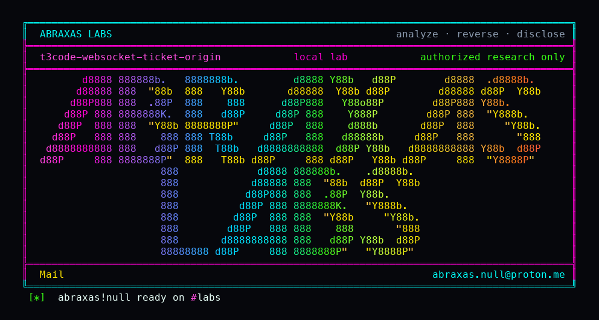

<p align="center">
  
</p>

# t3code-websocket-ticket-origin

A socket ticket in the URL does not care which website asked for it. Cookie sessions with a hostile Origin are rejected. Cookie sessions with no Origin header are accepted. Bearer tokens ignore Origin on purpose. The session cookie is `SameSite=Lax`, which is what currently stops a cross-site cookie WebSocket.

**Class:** Origin leftover
**Reach:** Local / ticket holder (hostile Origin on `wsTicket`; missing Origin on cookies)

**T3 Code** `61c3794c` - Ping

| | |
|---|---|
| ID | no CVE yet |
| Class | **Origin leftover** |
| Reach | **Local** (ticket in the upgrade URL, or a cookie client that omits Origin) |
| CWE | [CWE-346](https://cwe.mitre.org/data/definitions/346.html) / [CWE-200](https://cwe.mitre.org/data/definitions/200.html) |
| CVSS | **Low: 3.1** `CVSS:3.1/AV:N/AC:H/PR:L/UI:R/S:U/C:L/I:L/A:N` |
| Product | [T3 Code](https://github.com/pingdotgg/t3code) |
| Affected | **61c3794c32b0eeebfac09add43e403618c65d2d7** |
| Auth | valid `wsTicket` or browser session cookie |
| License | [GNU Affero GPL v3.0](LICENSE) |
| Lab | production `authenticateWebSocketUpgrade` on the Effect test layer |

## What an attacker can do

Needs a live `wsTicket` or a cookie that the browser will attach. Lax cookies are not attached to a cross-site WebSocket handshake in current browsers. A ticket in the query string is the path that skips Origin entirely.

| Privilege | Method / sink | Recon / integrity / availability | Lab-proven or inferred |
|---|---|---|---|
| Authenticate a `/ws` upgrade with a ticket and a hostile Origin | `authenticateWebSocketUpgrade`, `wsTicket` query | Integrity (session on the socket) | Lab-proven. ticket-hostile-origin=accepted, Origin `https://evil.example` |
| Authenticate a cookie upgrade with no Origin | cookie fallback through `isBrowserOriginAllowed` (`origin === undefined` returns true) | Integrity | Lab-proven. cookie-missing-origin=accepted |
| Authenticate a Bearer upgrade from a hostile Origin | same authenticator, Authorization header | Integrity | Lab-proven. bearer-hostile-origin=accepted (product test; not a cookie) |
| Negative control: cookie + hostile Origin | Origin `http://192.168.1.50:8080` | n/a | Lab-proven. rejected `ServerAuthInvalidCredentialError` |
| Negative control: cookie + trusted Origin | same-host Origin | n/a | Lab-proven. accepted |

**Stays closed on this leftover**

| Axis | Method / sink | Why it is closed |
|---|---|---|
| Integrity | Cookie WebSocket from a random website with an Origin header | `isBrowserOriginAllowed` rejects; SameSite=Lax also withholds the cookie |
| Integrity | Unauthenticated `/ws` | missing credential fails |
| Integrity | Cross-site cookie CSRF in current browsers | `Cookies.set` `sameSite: "lax"` in `apps/server/src/auth/http.ts` |

The audit line "no Origin check anywhere on the upgrade path" is too wide. Cookie hostile Origin is rejected on this pin. The leftover is the ticket path and the missing-Origin cookie branch.

## How I found it

GET `/ws` calls `authenticateWebSocketUpgrade`. If `wsTicket` is present, the function verifies the ticket and returns before `isBrowserOriginAllowed`. Cookie fallback does call it. I minted a ticket and a cookie session on the EnvironmentAuth test layer and sent the Origin matrix through the production function.

Wrong turns: reporting "no Origin check" for cookie upgrades (hostile Origin is rejected).

## Lab

```bash
python3 t3code-websocket-ticket-origin-Abraxas-Labs.py
```

or:

```bash
cd lab
./run.sh
```

```text
IOC cookie-missing-origin=accepted
IOC cookie-hostile-origin=rejected
IOC cookie-trusted-origin=accepted
IOC ticket-hostile-origin=accepted
IOC bearer-hostile-origin=accepted
IOC samesite=lax
SUCCESS T3-F04-WSORIGIN t3f04o6n1
```

## The fix

Run `isBrowserOriginAllowed` on the ticket path too, or bind tickets to the Origin that minted them. Treat a missing Origin as a failure for cookie credentials instead of a pass. Add an explicit Origin allowlist on the upgrade (`devOrigin`, `t3code://app`, configured tunnel hosts). Keep `SameSite=Lax` (or Strict).

## References

- [github.com/pingdotgg/t3code](https://github.com/pingdotgg/t3code) `61c3794c32b0eeebfac09add43e403618c65d2d7`
- [`EnvironmentAuth.authenticateWebSocketUpgrade`](https://github.com/pingdotgg/t3code/blob/61c3794c32b0eeebfac09add43e403618c65d2d7/apps/server/src/auth/EnvironmentAuth.ts)
- [CWE-346](https://cwe.mitre.org/data/definitions/346.html) · [CWE-200](https://cwe.mitre.org/data/definitions/200.html)

## License

GNU Affero GPL v3.0. See [LICENSE](LICENSE). Loopback lab only. No warranty.

Abraxas Labs
abraxas.null@proton.me

Please credit CVE to Abraxas Labs.
